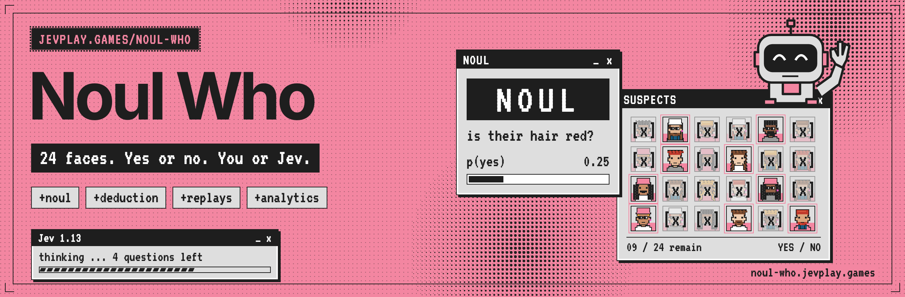
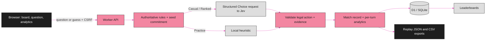

<p align="center"></p>

<div align="center">

# Noul Who

**Find the hidden character in fewer yes/no questions than Jev, then read the evidence behind every one of its decisions.**


[Quick start](#quick-start) · [How it works](#how-it-works) · [Turn on Jev and Discord](#turn-on-actual-jev-and-discord) · [What is implemented](#what-is-implemented) · [Analytics](#analytics-entry-points) · [Validation](#included-validation-evidence) · [Benchmarks](#run-live-benchmarks-deliberately) · [Browser tests](#browser-tests) · [Repository layout](#repository-layout) · [Contributing](#contributing)

</div>

---

Noul Who is a yes/no deduction duel. You and Jev each hold a secret character from the same 24 original portraits; every turn is one yes/no question or one final guess, and the first correct guess wins. The name comes from Noul, one of Jev's three decision types. The server owns the secrets and the rules, and every match keeps a verifiable replay with per-turn analytics. It is part of [jevplay.games](https://jevplay.games). `noul-who.jevplay.games` goes live at the hostname cutover; until then the game is served from its previous hostname.

> [!NOTE]
> **What is measured and what is not.** Local practice runs without credentials and is labeled as a deterministic local heuristic, not Jev. The tests use mocked TypeSafe and Discord services, and the bundled benchmark plays scripted local policies: it is not evidence of live Jev strength. “Exhaustive initial-position coverage” means every secret pair and starter under the tested policies, not every strategy, browser or attack. Selection confidence is not a win probability. See [Important interpretation boundaries](#important-interpretation-boundaries).

## Quick start

Use Node.js **22.13 or later**. This package was tested with **Node 22.16.0**; its built-in SQLite module emits an experimental-feature warning on that version.

```sh
cd jev-noul-who
npm start
```

Open `http://localhost:8787` in your browser. Choose **Practice · local opponent**, then **New game**. This is explicitly labeled a deterministic local heuristic, not Jev.

No `npm install` is needed for the local runtime or unit/API tests.

```sh
npm test
npm run benchmark
npm run check
```

The local server stores its database in `data/noul-who.sqlite`; a checkout from before the rename that only has `data/guess-who.sqlite` keeps using that file. That directory is intentionally excluded from the ZIP and Git. Do not put the repository root behind a static file server: only `public/` is public.

## How it works



Both players have independent secrets drawn from a committed seed. Answers and eliminations are computed by the server, never by the model, and Jev only ever picks from the legal candidate actions it is shown.

## Turn on actual Jev and Discord

Copy `.env.example` to `.env`, enter credentials, and restart. `npm start` reads the optional `.env` file. The required variables and deployment steps are in [docs/DEPLOYMENT.md](docs/DEPLOYMENT.md).

```sh
# macOS / Linux
cp .env.example .env

# PowerShell
Copy-Item .env.example .env
```

Configure `TYPESAFE_API_KEY` to use real Jev for **Casual** play. Keep `JEV_MODEL` pinned. Configure Discord OAuth to unlock signed-in history and ranked play. A `/play-jev` guild command creates a signed, short-lived launch token bound to the invoking Discord account for channel/server attribution.

A missing key, unavailable provider, invalid response, or timeout never silently becomes “Jev.” Fallback is explicitly displayed and permanently disqualifies that match from official ranking. Practice remains available.

## What is implemented

| Area | Included |
|---|---|
| Gameplay | Two deduction boards, independent secrets, automatic truthful answers, legal-question filtering, final-guess confirmation, resignation, server expiration |
| Opponents | Four Jev evidence/search configurations; local practice; deterministic fallback; bounded structured Choice adapter |
| Integrity | Server-only live secrets, seed commitments, replay verification, legal-action validation, compare-and-swap revisions, persisted turn leases, idempotent writes |
| Discord | `identify` OAuth, secure application sessions, Ed25519 interaction validation, user-bound launch-token redemption |
| Rankings | World/server/channel scopes, difficulty and immutable league separation, Wilson lower-bound ordering, provisional status, signed snapshot pagination |
| Player analytics | Per-turn elimination and entropy, question quality, guessing risk/calibration, latency distributions, cohorts, streaks, history and exports |
| Provider analytics | Candidate evidence, distributions, confidence, search estimates/regret, attempts/retries/errors, known token usage, configurable cost inputs |
| Operations | Pseudonymous activity, retention cohorts, event-count funnel, request rejections, provider attempts including discarded responses, retention controls |
| Delivery | Desktop/mobile UI, accessible text cards, CSV/JSON exports, test suite, benchmark harness, reports and screenshots |

## Analytics entry points

Use the **Analytics** tab for the current match and your stored history. Filter by difficulty, match type, and starter. Download the full report JSON, match-summary CSV, or per-turn CSV. Completed server matches also export a replay JSON.

For an operator-only local SQLite export (defaults to the same database file as `npm start`):

```sh
node scripts/export-analytics.mjs --db=data/noul-who.sqlite --out=reports/operator-export
```

This exports aggregate operations, match summaries, and decision CSVs. It does **not** export OAuth credentials, live secrets, seeds, Discord IDs, or display names. Coverage limits and truncation are explicit. [docs/ANALYTICS.md](docs/ANALYTICS.md) defines the metrics, formulas, cohorts, missing values, privacy boundaries, and limitations.

Replays exported before the rename carry the game id `guess-who`; they still verify with `npm run verify -- <file>`.

## Included validation evidence

See [reports/VALIDATION.md](reports/VALIDATION.md) for the final recorded counts and environment. The package includes deterministic tests over all **1,152** initial secret/starting-player configurations, scripted benchmark results for **5,760 matches**, and browser-rendering/interaction evidence.

The benchmark is **not a live Jev benchmark**. Provider behavior and Discord identity were integration-tested with mocks. Browser checks in this build used local assets plus an HTTP bridge because direct navigation was blocked in the build environment. Production Cloudflare deployment, live Discord authorization, and authenticated TypeSafe requests were not performed.

## Run live benchmarks deliberately

The default benchmark makes **zero external inference calls**. Live inference requires both a key and explicit paid-call authorization:

```sh
# Environment must supply TYPESAFE_API_KEY.
node --env-file-if-exists=.env benchmarks/run.mjs --live --confirm-paid --limit=24 --difficulty=jev --out=reports/live-jev

# Separate Jev-vs-Jev experiment; both sides make real provider calls.
node --env-file-if-exists=.env benchmarks/run.mjs --live --confirm-paid --jev-vs-jev --limit=24 --out=reports/live-selfplay
```

Increase `--limit` to 1152 for complete initial-position coverage. `--repeats=N` repeats those scenarios. Each match can make multiple paid requests. Fallback matches are excluded from strict live-opponent results.

## Browser tests

Python and Playwright are **optional development dependencies**, not game/runtime dependencies.

```sh
pip install playwright
python -m playwright install chromium
# Start npm start in a separate terminal first.
npm run test:browser
```

`GW_BASE_URL` changes the test server; `GW_CHROMIUM` selects an installed Chromium executable. `GW_INLINE_FIXTURE=1` selects the documented local render/API-bridge fixture. The test report records the selected transport rather than claiming real-browser HTTP coverage when using the fixture.

## Repository layout

```text
public/                    page, styling, pixel-art portraits, shared rules/strategy/analytics
  brand/                   shared jevplay.games shell (brand.css, fonts, icons)
  shared/                  deterministic engine used by browser and server
server/                    trusted API, persistence, OAuth/context, Jev adapter, replay validation
migrations/001.sql         concrete SQLite/D1 schema and indexes
scripts/                   local server, D1-compatible SQLite adapter, verification and operations tools
tests/                     rules, strategy, analytics, security, provider, API, ranking, rename and browser tests
benchmarks/                reproducible scripted and opt-in live experiments
docs/                      A–Z engineering reference, analytics, API, deployment, security, agent handoff
reports/                   actual test logs, benchmark data, validation notes, sample replay, screenshots
assets/                    README banner and GitHub social preview (sources in assets/src/)
dist-hub/                  noul-who.png og card and alt text, copied by hand to the hub's /brand/og/
source/original-requirements.md   supplied requirements, retained separately from authored code
```

### Important interpretation boundaries

“Exhaustive initial-position coverage” means every secret pair and starter was exercised under the tested policies. It does not mean every possible strategy, browser, failure interleaving, or security attack was tested.

Selection confidence is not a win probability. Search probabilities are estimates under a stated policy model. Unknown measurements remain `null`. Partial provider usage is never labeled a complete bill. Community context is a short-lived launch-time proof, not continuous Discord membership surveillance.

Review the deployment checklist before exposing ranked play publicly. The code is a tested implementation package, not a claim of independent security certification.

## Contributing

Issues and pull requests are welcome. Run `npm test` and `npm run check` (syntax, roster and the 150 KB gzip asset budget) before opening a pull request, keep `public/shared/` free of DOM and I/O, and do not change stored identifiers (match format, rules/roster versions, seed derivation) without a version bump: matches, replays and launch tokens created before the Noul Who rename (game id `guess-who`) must keep verifying. Licensed under the [MIT License](LICENSE).

<p align="center">
<sub>A jevplay.games game · Steward: CompleteTech LLC · MIT licensed<br>
Not an official TypeSafe AI publication; the pink, ink and pixel-window styling is a nod to <a href="https://typesafe.ai">typesafe.ai</a>. Jev, System One and TypeSafe are their respective owners' names.</sub>
</p>
